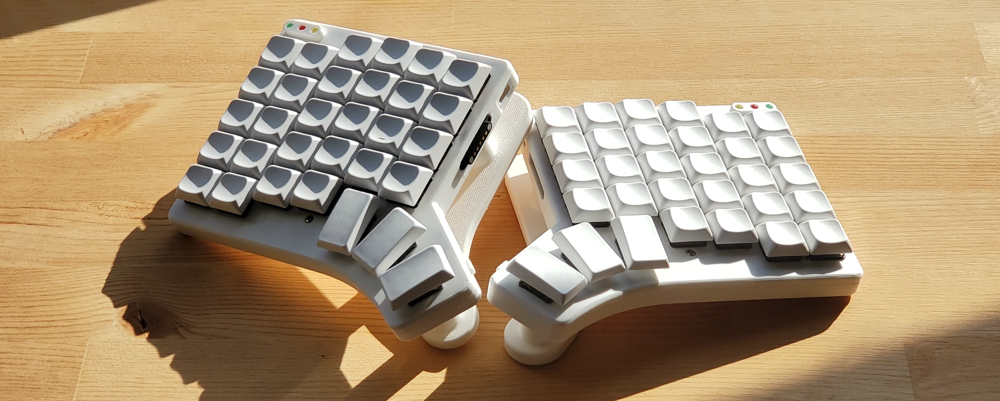

# Mica Keyboard



A fully custom keyboard, inspired by Christian Selig's [Caldera](https://christianselig.com/2024/07/caldera-keyboard/) and aided by FlatFootFox's [Ergogen tutorials](https://flatfootfox.com/ergogen-introduction/).

The Mica keyboard is
- **split + ortholinear** to facilitate long typing sessions,
- **fully wireless** via BLE between the keyboard halves and the host,
- **portable** with a thin profile and magnetic tenting legs for quick setup and teardown, and
- **modular** via an I2C bus connected to ports on the left, right, and top of the case.
    - *Note: no I2C modules have been created to interface with the keyboard yet.*

## Instructions

If you would like to build this keyboard:

1. get the files from the [Releases](https://github.com/ilauzon/mica-keyboard/releases) section.
    - Gerber files to send to a PCB manufacturer
        - `gerbers_left.zip`
        - `gerbers_right.zip`
    - 3D models of the case to print
        - `bottom.stl` - mirror for the right half
        - `top.stl` - mirror for the right half
        - `switch.stl`
        - `led_case.stl`
        - `tent_foot.stl` - mirror for the right half
    - Firmware to flash onto your microcontroller (a nice!nano V2)
        - `zmk_left.uf2`
        - `zmk_right.uf2`
        - `settings_reset.uf2`
2.  Read the [build instructions](docs/build-instructions.md) to put it all together.

## Building firmware from source

Building from source has only been tested on Linux (Fedora).

```sh
cd firmware
make
```

This will build three `uf2` files in `firmware/build`: `zmk_left.uf2`, `zmk_right.uf2`, and `settings_reset.uf2`. Flash each half of your keyboard accordingly.

The Makefile pulls down the ZMK source tree and build tools to build the firmware, so the first build will be glacially slow. Subsequent builds should be reasonably fast.

I opted to configure my project to build the firmware locally instead of ZMK's recommended approach of using GitHub Actions. I wanted to be able to test out features quickly without commiting and pushing every test. I followed ZMK's [Podman guide](https://v0-3-branch.zmk.dev/docs/development/local-toolchain/setup/container?container=podman) - refer to this if you want to change the build options.

