# Assembling the keyboard

This document describes how to put the keyboard together once you have the PCB, case, and firmware, the latter available in the [Releases](https://github.com/ilauzon/mica-keyboard/releases) section. It assumes you have already 3D-printed the case and have had the PCB manufactured.

## Bill of materials
- 2x nice!nano microcontroller
- 62x Kailh Choc V1 switch
- 62x Kailh Choc hotswap socket
- 62x [4148 SMD diode](https://typeractive.xyz/products/smd-diodes), or through-hole diodes (both will work with this PCB)
- 2x [JSTPH 2.0mm battery input jack](https://typeractive.xyz/products/battery-jack)
- 2x [Panasonic miniature reset button](https://typeractive.xyz/products/reset-button)
- 2x [Alps miniature SPDT power switch](https://typeractive.xyz/products/power-switch)
- 56x 1U Kailh Choc V1 keycaps
- 6x 1.5U Kailh Choc V1 keycaps (for thumbs)
- 2x PS3 controller replacement battery
- 2x Mica PCB
- 1x 3D-printed Mica case (composed of 4 parts: left bottom, left top, right bottom, and right top)
- 2x 3D-printed Mica power switch covers
- 2x 3D-printed Mica LED covers
- 6x 3mm LED (any colour)
- 6x 0805 SMD resistor (calibrate resistance to LED colour)
- 10x M2 screw (5-8 mm in length)
- 10x M2x5 F/F standoffs
- 48x diode legs or pin headers (to solder the microcontrollers to the PCBs. However, I strongly recommend you use [Mill-Max sockets](https://www.mill-max.com/) instead, to easily remove the microcontrollers if problems arise.)

### Optional I2C Bus Addons
If you would like to attach I2C devices to the sides of your keyboard, include:
- 6x pairs of [bent magnetic pogo pin connectors](https://www.amazon.ca/Magnetic-Connector-Location-Connectors-7Pin/dp/B0D44WD5C5?th=1)
    - Ensure they have a pitch of approximately 2.54 mm if you need to source them from elsewhere.

### Optional Tenting Attachments
If you would like tenting attachments, include:
- 1x 3D-printed Mica tent leg (left)
- 1x 3D-printed Mica tent leg (right)
- 8x D12X2 mm neodymium magnets
- Cyanoacrylate glue (superglue)

### Optional Non-Slip Feet
If you want non-slip feet on the bottom of the keyboard and tenting attachment, include:
- 16x 5x2mm [silicone feet](https://www.amazon.ca/uxcell-Cabinet-Self-Adhesive-Cupboard-Furniture/dp/B0CT5BLWZH?th=1)

## Equipment
The following equipment is needed to assemble the keyboard.
- Soldering equipment for small electronics 
    - Soldering iron
    - Solder
    - Brass wire / wet sponge for cleaning
    - A well-ventilated area
- Tweezers, used for precise placement of small parts
- Flush cutters
- 2x USB-C cable
- Philips-head screwdriver
- Multimeter with a diode mode (optional if you have really good eyesight and/or a magnifying glass)

## Instructions
This assembly guide has the following sections, in order:
1. **Assemble the electronic components for the left half of the keyboard**. At the end of this section, the left half of the keyboard will be able to send keystrokes over Bluetooth to your computer, using only battery power.
2. **Assemble the electronic components for the right half of the keyboard**. At the end of this section, the right half of the keyboard will be able to talk to the left over Bluetooth, which will relay keystrokes to your computer.
3. **Assemble the case**. At the end of this section, the keyboard will be complete.

### Create the Left PCB Assembly
This part of the guide instructs you on how to attach the electronic components to the PCB for the left half. At the end of this section, you should have something that can connect to your computer off of battery power only, and send keystrokes to it.

1. Orient the left-hand PCB so that the side with the ground plane faces up, which will be referred to as the back of the PCB.

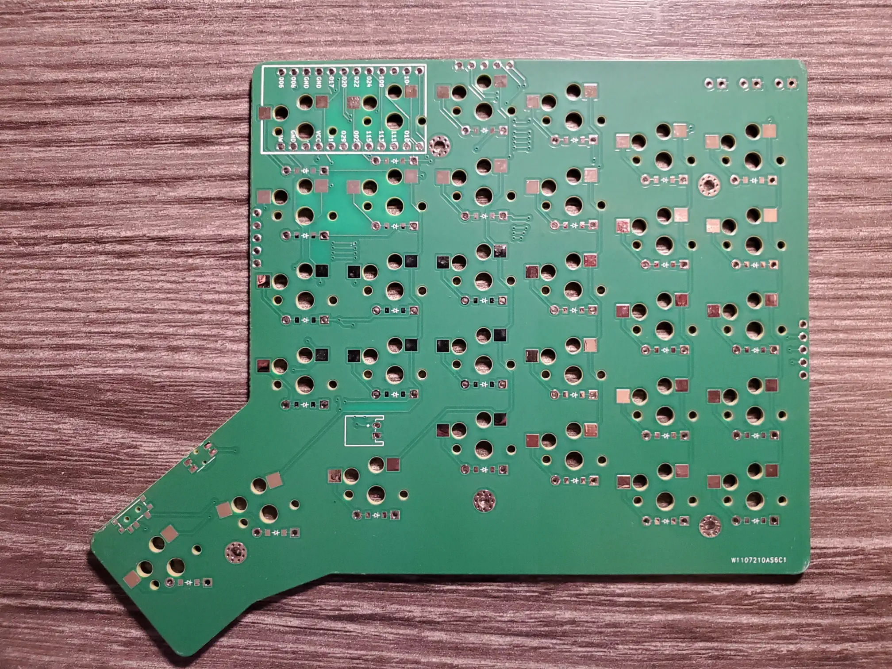
*The back of the left-hand PCB.*

2. Solder 31 hotswap sockets to the back of the PCB.

>[!IMPORTANT]
> Diodes only allow current in one direction. Make sure you know what direction to solder them in. Use your digital multimeter's diode mode to check this, or examine the casing of the diode for a line to align with the silkscreen drawing.
> 
> See https://www.allaboutcircuits.com/textbook/semiconductors/chpt-3/meter-check-of-a-diode/ for more info.

3. Solder 31 diodes to the back of the PCB, below the hotswap sockets.

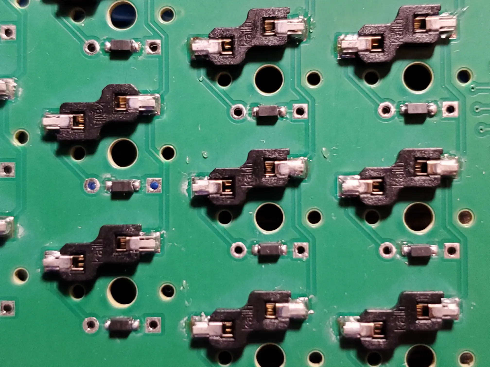
*How the soldered hotswap sockets and diodes should look.*

> [!IMPORTANT]
> The silkscreen outline of the battery jack is flipped 180 degrees from its correct orientation (sorry). See the image below the following step for the correct orientation to solder the battery jack.

4. Solder the JSTPH battery input jack to the back of the PCB *flipped 180 degrees to the silkscreen outline*.

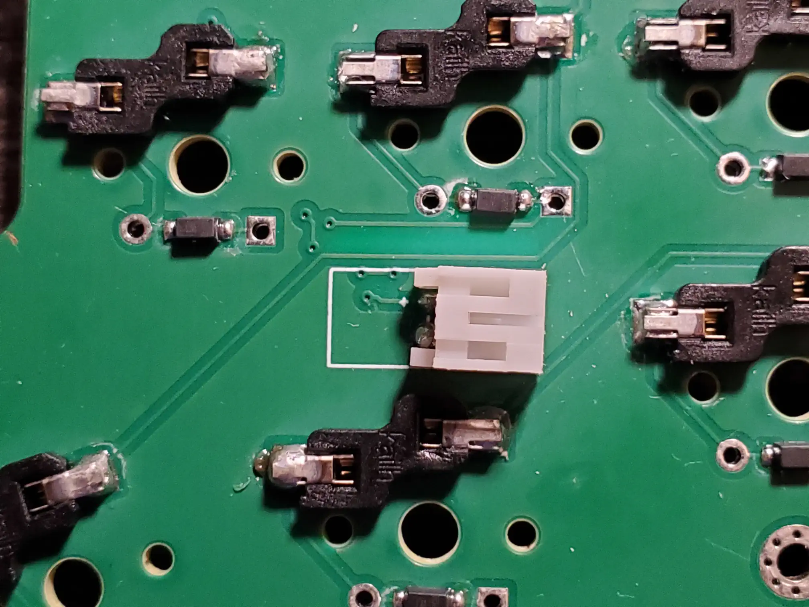
*The correct orientation of the battery jack.*

5. Solder the power switch and reset button to the back of the PCB.

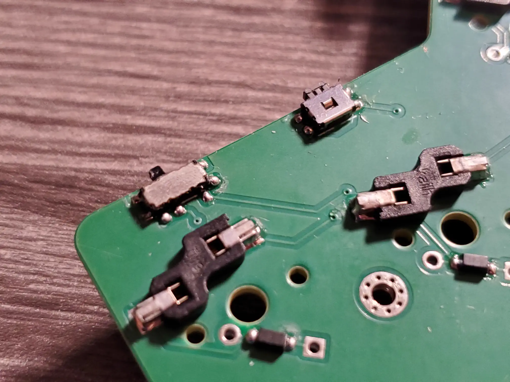
*The power switch (left) and reset button (right) soldered.*

6. Solder the nice!nano to the back of the PCB. The USB-C port should rest on top of a hotswap socket, with the nice!nano resting parallel to the PCB. This should leave a small gap between the other hotswap socket below the nice!nano and the chip on the nice!nano.
    - 6.1. Solder the header pins / diode legs (henceforth referred to as "legs") to the nice!nano.
    - 6.2. Trim the legs poking out the back of the nice!nano so they sit reasonably close to flush. You may need to heat some joints back up to remove excess solder.

    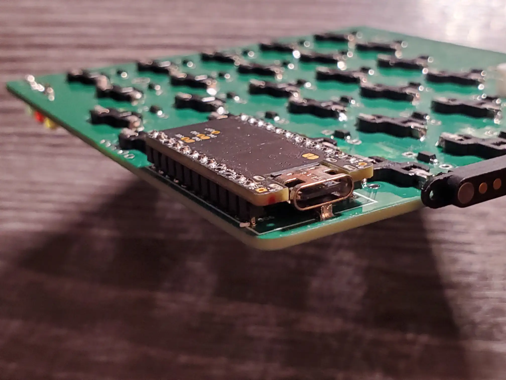
    *Trimmed legs on the back of the nice!nano.*

    - 6.3. Place the nice!nano on the back of the PCB, threading the legs through the holes in the PCB.
    - 6.4. Flip the PCB over, keeping the nice!nano on the back of the PCB.
    - 6.5. Solder the four corner legs on the front of the PCB to keep the nice!nano firmly in place.
    - 6.6. Trim the legs so that they sit as close to flush as possible on the front of the PCB. It is important to trim the lower row of legs to be very flush, since switches will sit directly on top of these joints.
    - 6.7. Solder the rest of the legs. 

    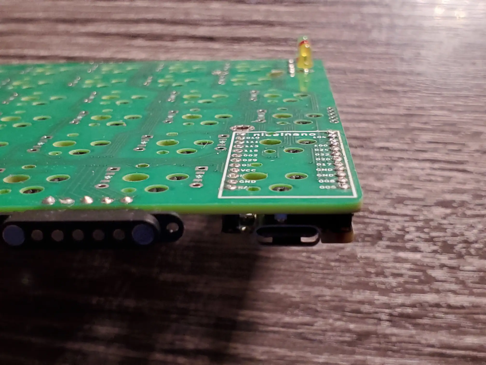
    *Trimmed legs on the front on the PCB. Notice how the row on the left is trimmed more than the one on the right.*

7. Plug in the battery to the battery jack on the back of the PCB.

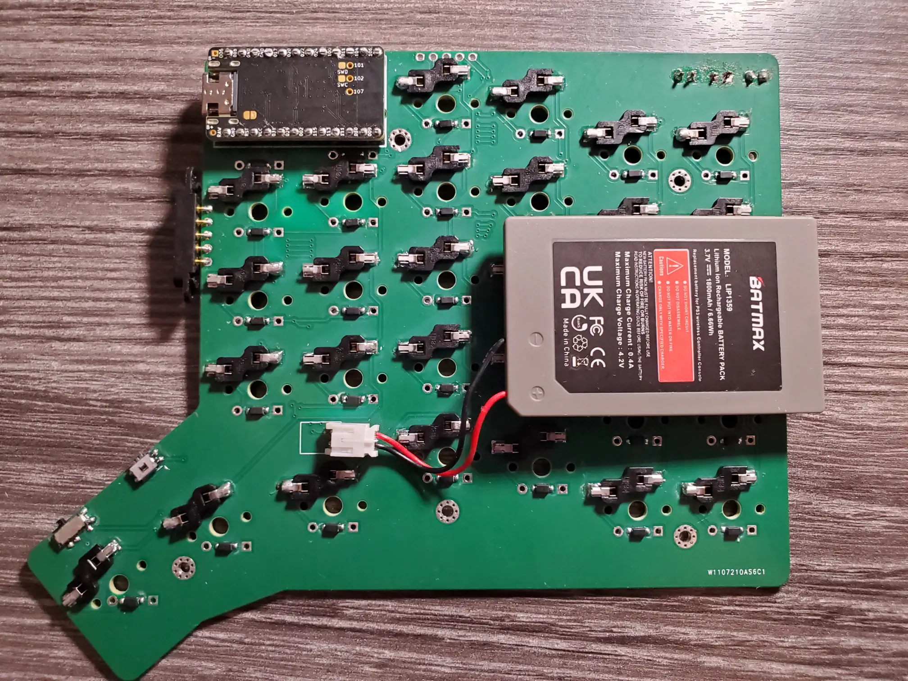
*The battery plugged into the back of the PCB.*

> [!WARNING]
> The black handle of the power switch is extremely fragile. If a force is applied along the switch's shortest axis, the handle WILL snap and you will not be able to reattach it. Ask me how I know.
> 
> Make sure to only apply force to the handle parallel to the switch's longest axis.

8. Test that the battery, nice!nano, and power switch are operating correctly: Flip the power switch to the on position (pushed towards the nice!nano). The nice!nano should turn on, indicated by a status LED on the PCB-facing side of the nice!nano board.

9. **If you want an I2C bus**, now is the time to solder three female pogo pin connectors to the back of the PCB on the top, left, and right. See the picture in Step 7 demonstrating the correct orientation. Clip the pogo pin connector legs sticking out the front of the PCB.

10. Solder the 0805 resistors and LEDs to the front of the PCB. 
    - Ensure that the LEDs are oriented correctly. See the picture below for the correct orientation.
    - Ensure that the LEDs are raised from the board by at most 1.5 mm, otherwise they will not seat into the front of the 3D-printed case (this is tricky to do cleanly, as you can see in the picture).

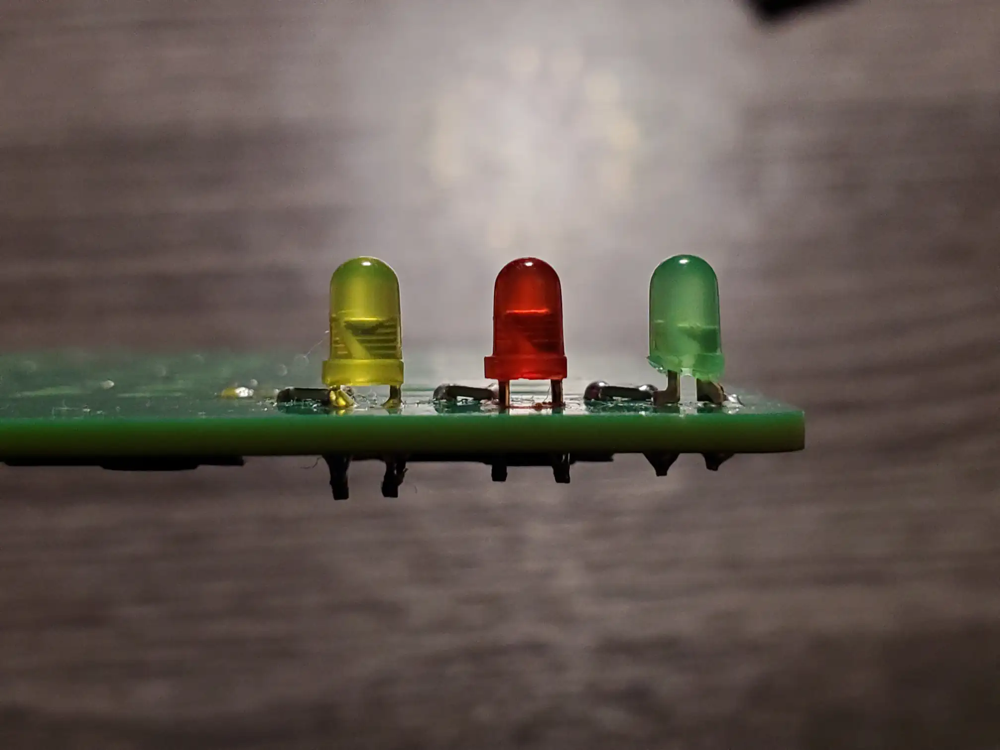
*The LEDs soldered to the PCB in the correct orientation, and their accompanying resistors.*

11. Clip the excess length from the legs of the LEDs on the back of the PCB. After this step, all soldering is done.

12. Connect the nice!nano to your computer with a USB-C cable.

13. Flash the left half of your keyboard with the required firmware.
    - 13.1. Double-press the reset button. You should see an external storage device be detected by your computer.
    - 13.2. Mount the storage device.
    - 13.3. Copy `zmk_left.uf2` to the storage device. The storage device should unmount itself shortly after doing so.

14. Check for an available Bluetooth device named "Mica Keyboard" on your computer. There should be one visible. Pair with it.
    - If you ever need to unpair the device, resetting it alone will not work. You must re-flash the device with `settings_reset.uf2`, then `zmk_left.uf2` before attempting a fresh pairing.
    - Multiple Bluetooth devices are supported by ZMK, the underlying firmware, but are not configured for this keyboard. See [ZMK Bluetooth bindings](https://v0-3-branch.zmk.dev/docs/keymaps/behaviors/bluetooth) and edit `firmware/mica-shield-module/board/shields/mica/mica.keymap` to map Bluetooth behaviours to your keyboard.

15. Place a single Kailh Choc switch in the hotswap socket directly to the right of the bottom-middle screw hole. Press it. The innermost LED should light up. If it doesn't, ensure that you have a resistor of the correct resistance for that LED.

16. Try inserting and pressing a few other switches to ensure that keystrokes are being transmitted to your computer.

17. Remove all Choc switches, unplug your keyboard, and ensure that the power switch is in the off position (pushed away from the nice!nano).

This concludes the section on assembling the electronic components for the left half of the keyboard.

### Create the Right PCB Assembly
For this part of the guide, follow the instructions for the left half with these modifications:
- **Step 4**: The silkscreen for the battery jack on the right half is incorrect in the same way as the left.
- **Step 5**: If you want the power switches to be symmetrical, then you must flip the switch on the right side over, and bridge the gap between the PCB pads and the switch pads using either extra solder or diode legs. Examine the traces on the PCB to note which contacts are purely structural and can be shorted, and which must not be shorted.
- **Step 6**: the nice!nano on the right half should also face the PCB, in that it should be rotated 180 degrees around the shortest axis, not the longest axis. When in doubt, line up the silkscreen legend with the nice!nano pin labels.

### Case Assembly For Both Halves
This final section discusses how to assemble the final product after soldering the components to each half. These instructions will be for the left half, but all steps are mirrored for the right half.

1. Take the bottom of the case and place it flat-side-down. Take an M2x5 F/F standoff and place it over one of the protruding standoff holders. Heat up the standoff with a soldering iron while gently pressing the standoff into the holder. Insert the standoff until it is flush.
    - You may want to do this by applying heat to an M2 screw attached to the standoff to reduce the risk of directly contacting the case with the iron. This also helps ensure that the standoff is installed upright.
    - An iron temperature of around 350 degrees Fahrenheit works well for PLA.  

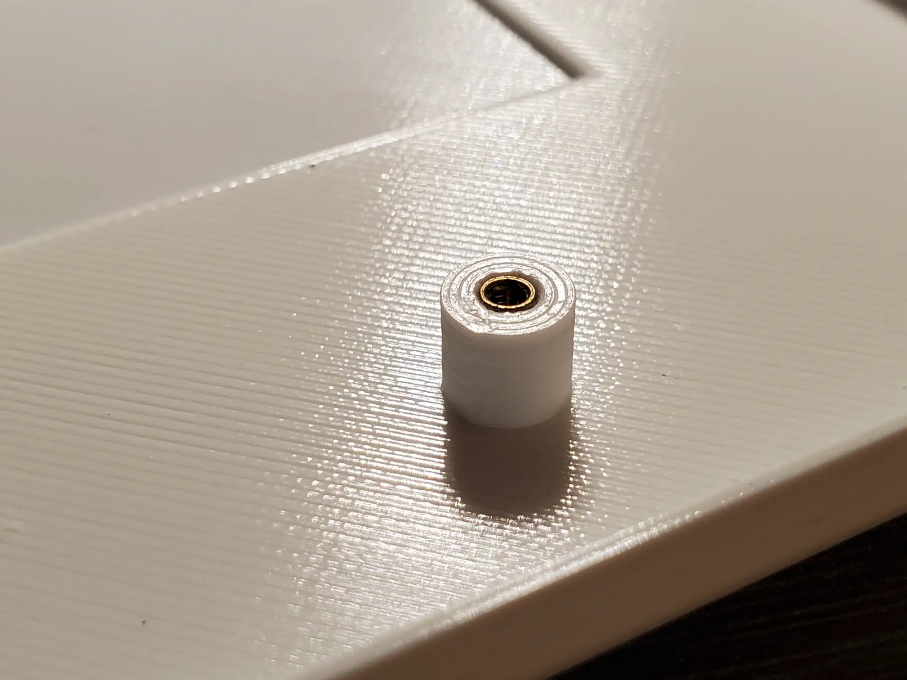
*An M2x5 F/F standoff fully inserted into its holder.*

2. Repeat for the other four standoff holders.

3. **If you want tenting attachments**:
    - 3.1. Take two D12x2 neodymium magnets.
    - 3.2. Decide which side you want to face down for each magnet. Scratch up that side with a sharp metal implement, like the screwdriver or tweezers. 
    - 3.3. Scratch up the surface inside the two circular recesses in the bottom of the case.
    - 3.4. Apply a small amount of superglue to the recesses, then press the two magnets into them firmly.
    - 3.5. Let dry for at least 10 minutes before continuing.

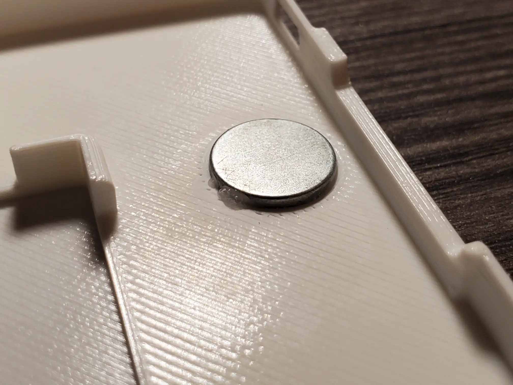
*One of the two magnets installed in the bottom half of the case.*

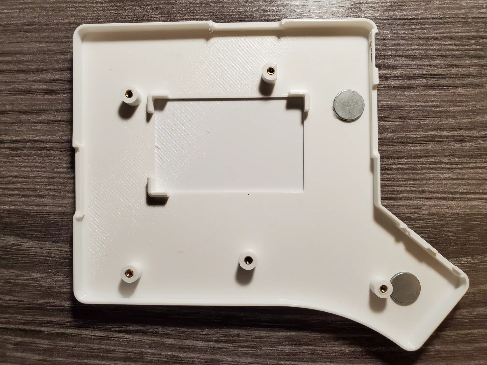
*The standoffs and magnets installed in the bottom half of the case.*

4. Take the top half of the case and place it flat side up. Take a 3D-printed LED cover.

5. Apply a very small amount of superglue to the pill-shaped insert in the top-left corner of the case part, and place the 3D-printed LED cover in this insert. Wipe out any excess superglue that leaked into the holes for the LEDs. Let dry for AT LEAST 2 hours. If you do not wait long enough, the superglue offgassing will leave an unsightly residue on the PCB and LEDs. This is a good time to begin assembly of the right half of the case up to this point.
    - With dark filaments, the superglue will sometimes leave a white residue around the joint. Fix this by applying acetone to the joint.

6. Place the top half of the case upside-down, and slide the left PCB assembly into the case. Ensure that the LEDs on the front side slot into the glued LED holder correctly.

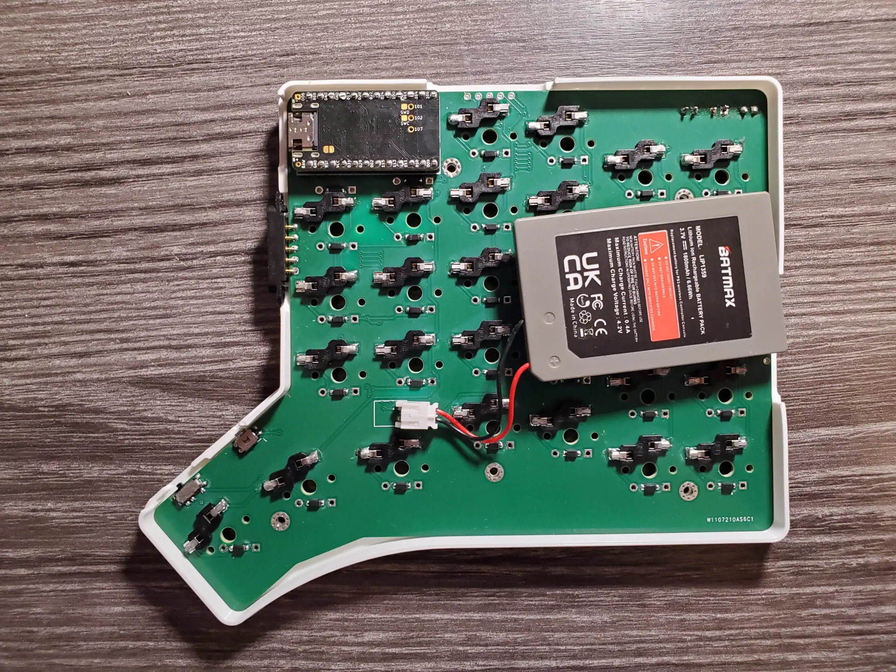
*The left PCB assembly inserted into the top half of the case.*

7. Slide the 3D-printed power switch cover into place on top of the power switch. Note that the switch is asymmetrical due to a misalignment in the case's switch hole. Test both the on and off switch positions to ensure that the edges of the switch cover are flush with the case in each positions. If not, flip it around.

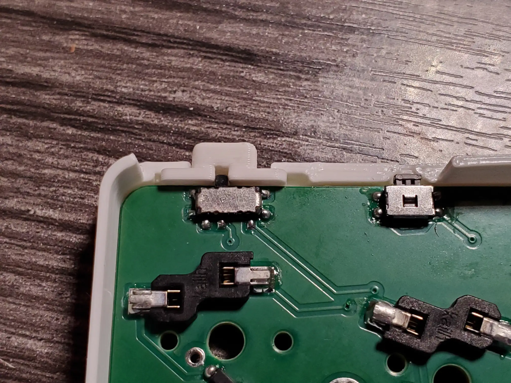
*The switch cover placed atop the switch in the correct orientation.*

8. Take the top assembly and the bottom half of the case. Take the battery in the top assembly and slot it into the cutout in the bottom half of the case, oriented so that the notched corner is placed in the cutout corner without a wall. Once the battery is placed, slide the two halves together.
    - Make sure the power switch cover does not fall out during this step.

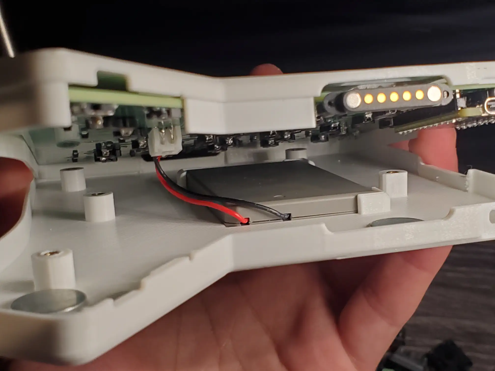
*Correct battery placement while putting the two halves together (the switch cover is erroneously missing in this photo).*

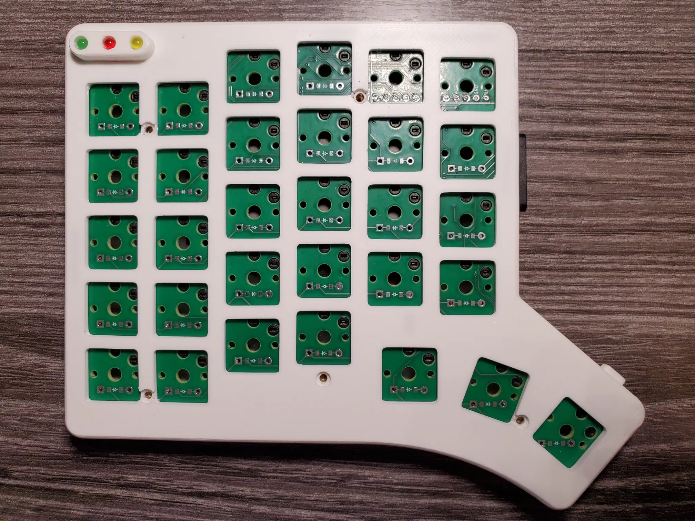
*The top and bottom halves of the case assembled.*

> [!WARNING]
> Do not overtighten the M2 screws during the next step. Overtightening may crack the fragile 3D-printed shelf for the head of the screw.

9. Screw an M2 screw into each of the five holes present on the front of the assembly. Do not overtighten them.

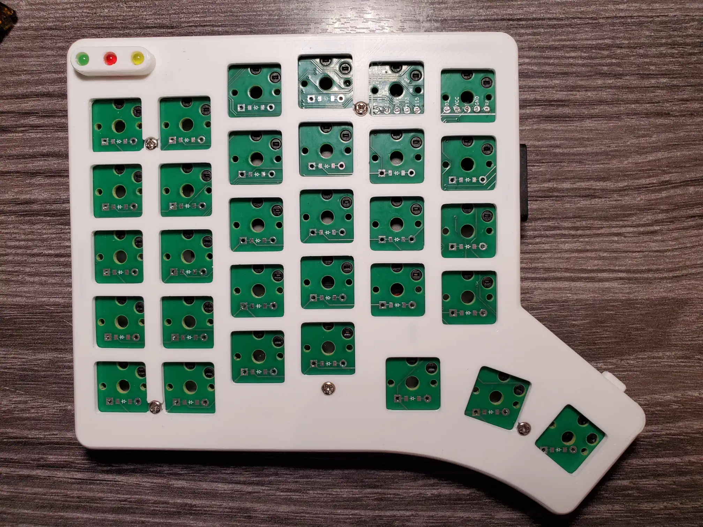
*The front and back halves of the case connected with five M2 screws.*

10. Place your Kailh Choc V1 switches into the hotswap sockets.
    - Note that the teeth on the sides of the switches will not expand upon installation. This is intentional, done to make removal of switches easier.

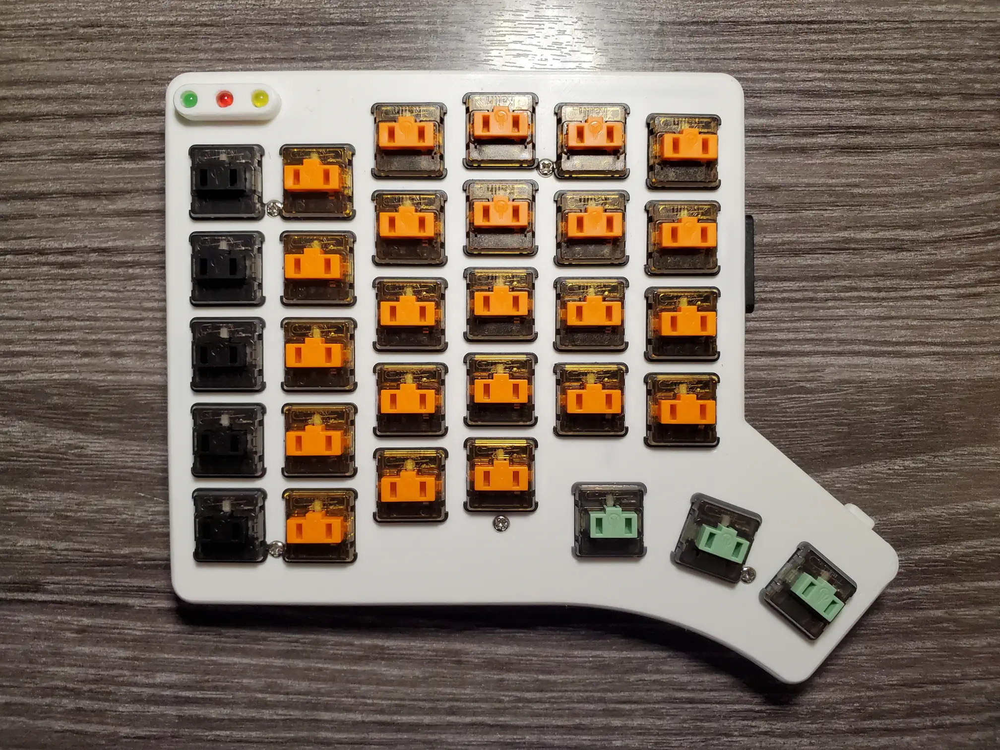
*The assembly with switches installed.*

11. Lastly, install the keycaps.

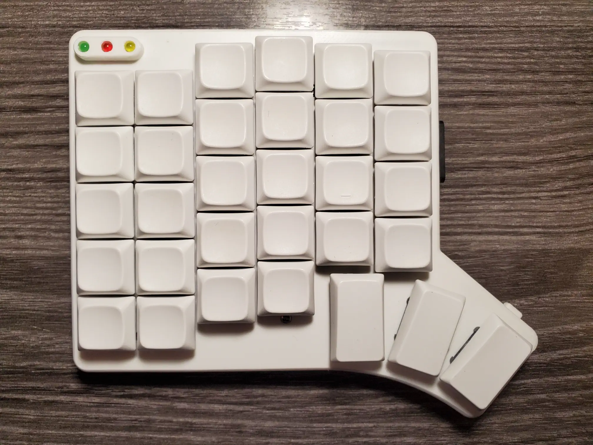
*The assembly with keycaps installed.*

> [!IMPORTANT]
> Before gluing, make sure that the polarity of the magnets in the tenting attachment match that of the magnets in the case so that the attachment will attach correctly.

12. **If you want tenting attachments**, follow the same process described in Step 3 to glue two more magnets to the two stands on the tenting attachment. Make sure that the polarity of the magnets is correct given the polarity of the magnets installed in the case.

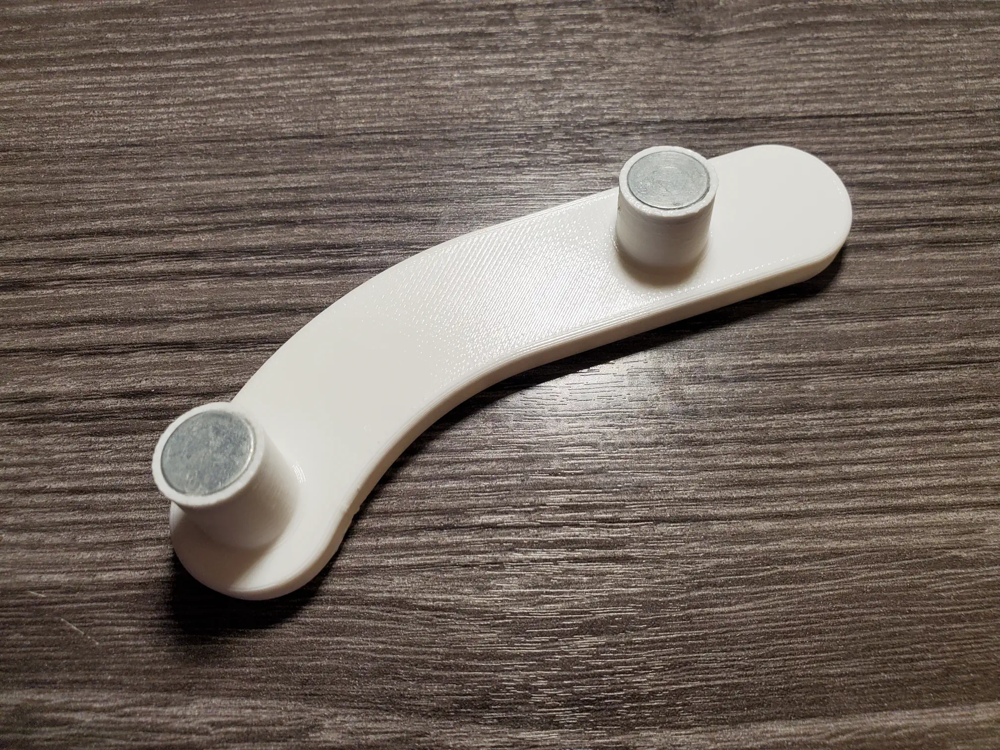
*Magnets installed in the tenting attachment.*

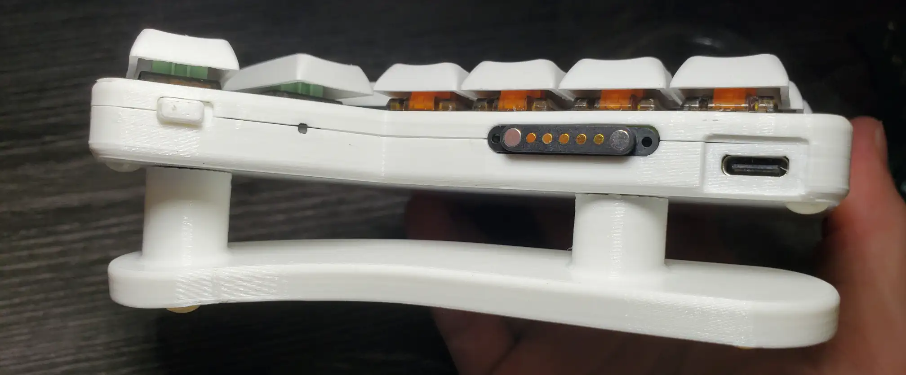
*How the tenting attachment attaches to the keyboard.*

13. **If you want non-slip feet**, flip the case (and the tenting attachment if you have it) over, and install the feet in the circular recesses there.

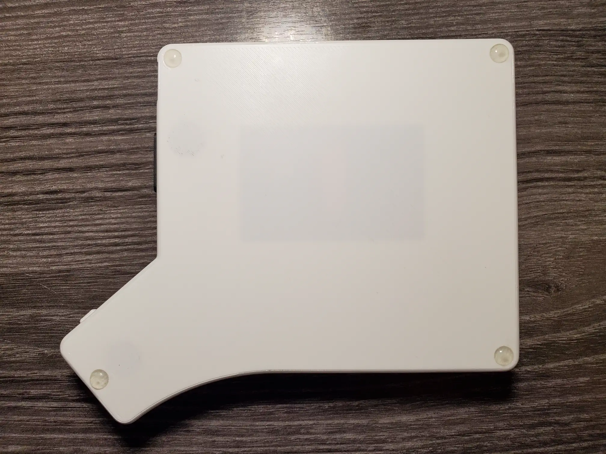
*The bottom of the case with four non-slip feet installed.*

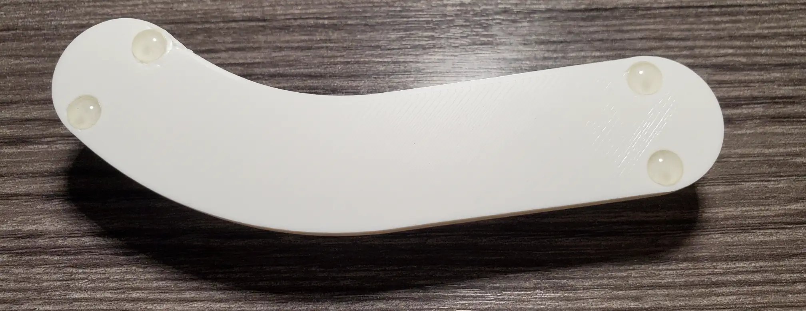
*The bottom of the tenting attachment with four non-slip feet installed.*

That is all! Assembly is complete.

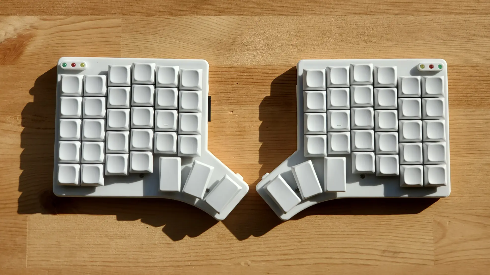
